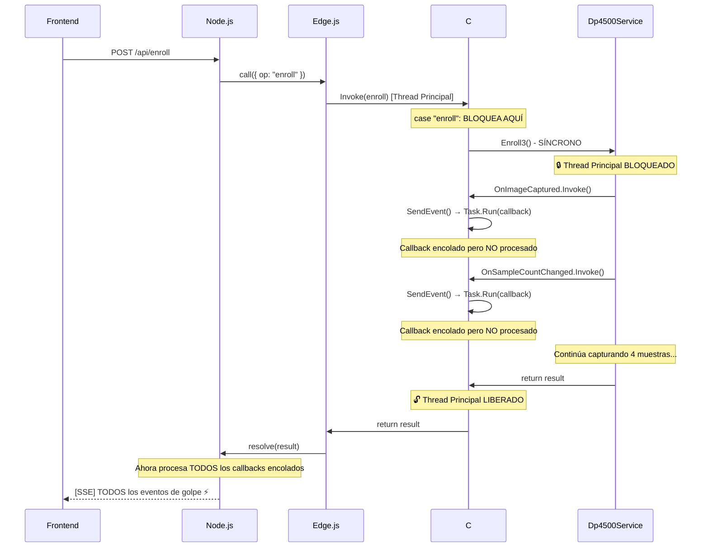
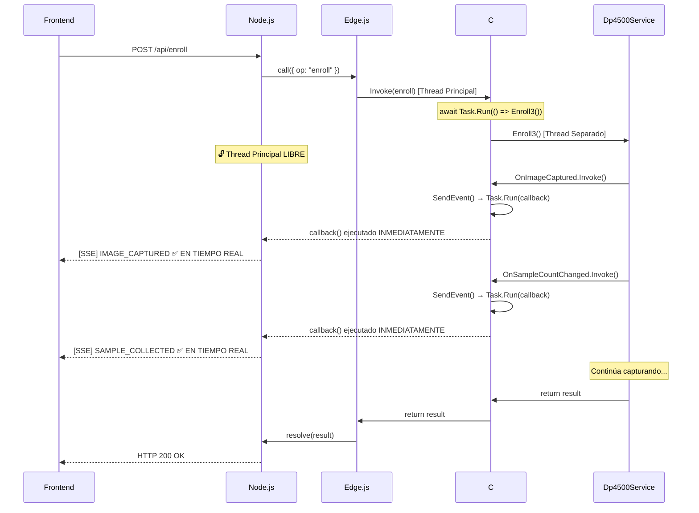

# Solución: Eventos en Tiempo Real para Operaciones Biométricas

## 📋 Resumen Ejecutivo

**Problema:** Los eventos de captura biométrica (imágenes, progreso, intentos) NO llegaban en tiempo real al frontend. Se recibían todos de golpe al finalizar el enrolamiento completo.

**Causa Raíz:** Las operaciones biométricas (`Enroll3()`, `VerifyLiveAgainstReg()`, `IdentifyLive1N()`) se ejecutaban **sincrónicamente**, bloqueando el thread principal de Edge.js/Node.js, impidiendo que los callbacks se procesaran hasta que la operación terminara.

**Solución:** Ejecutar las operaciones biométricas de forma **asíncrona** usando `await Task.Run(() => ...)` para no bloquear el thread principal de Node.js.

**Resultado:** ✅ Eventos llegan en tiempo real al frontend durante todo el proceso de captura.

---

## 🏗️ Arquitectura del Sistema

```
┌─────────────────────────────────────────────────────────────┐
│                    FRONTEND (Browser)                        │
│  index.html → BiometricAdapter → EventSource (/events)      │
└────────────────────────┬────────────────────────────────────┘
                         │
                         │ Server-Sent Events (SSE)
                         │
┌────────────────────────▼────────────────────────────────────┐
│                   NODE.JS (server.ts)                        │
│  Express + SSE Bridge + Edge.js Callback Handler            │
└────────────────────────┬────────────────────────────────────┘
                         │
                         │ Edge.js Bridge (V8 ↔ CLR)
                         │
┌────────────────────────▼────────────────────────────────────┐
│              C# BACKEND (EdgeUruBridge.cs)                   │
│  EdgeUruBridge → Dp4500Service → Hardware DP4500            │
│  - Callbacks con Task.Run()                                  │
│  - Operaciones biométricas (Enroll3, Verify, Identify)      │
└──────────────────────────────────────────────────────────────┘
```

---

## 🐛 El Problema Identificado

### Síntomas

1. Los logs `[EVENT]` aparecían en C# durante el proceso
2. Los logs `[DEBUG] Dentro de Task.Run para {eventType}` aparecían en C#
3. Pero los logs `[C# Event]` y `[EVENT SENT]` NO aparecían hasta el final
4. El frontend recibía TODOS los eventos de golpe al terminar el enrolamiento
5. No se veían las imágenes ni el progreso en tiempo real

### Logs del Problema

```
[EVENT] ENROLLMENT_STARTED: ...
[DEBUG] Usando Task.Run (fallback)
[DEBUG] Dentro de Task.Run para ENROLLMENT_STARTED

[EVENT] IMAGE_CAPTURED: Imagen capturada
[DEBUG] Dentro de Task.Run para IMAGE_CAPTURED

[EVENT] SAMPLE_COLLECTED: Muestra 1/4
[DEBUG] Dentro de Task.Run para SAMPLE_COLLECTED

[EVENT] IMAGE_CAPTURED: Imagen capturada
[DEBUG] Dentro de Task.Run para IMAGE_CAPTURED

...

[REG] Tag=REG-...
[EVENT] ENROLLMENT_COMPLETED: ...

// ⚠️ Todos los [C# Event] aparecen al final de golpe:
[C# Event] { evt: 'ENROLLMENT_STARTED', ... }
[C# Event] { evt: 'IMAGE_CAPTURED', ... }
[C# Event] { evt: 'SAMPLE_COLLECTED', ... }
[C# Event] { evt: 'IMAGE_CAPTURED', ... }
...
```

---

## 🔍 Análisis del Problema

### Secuencia del Bloqueo (Antes de la Solución)



### ¿Por Qué Pasaba Esto?

#### 1. **Edge.js y el Thread Principal**

Edge.js ejecuta código C# en el **mismo thread del event loop de Node.js**. Cuando el código C# es síncrono y de larga duración, **bloquea completamente Node.js**.

```csharp
// ❌ CÓDIGO PROBLEMÁTICO
case "enroll":
{
    // Esta línea BLOQUEA el thread principal hasta que termina (30-60 segundos)
    var result = _reader.Enroll3(cts.Token, targetFarn, maxRetries, maxSamples);

    // Durante esos 30-60 segundos, Node.js NO puede procesar NADA
    return new { ok = result.ok, ... };
}
```

#### 2. **Callbacks con Task.Run() Encolados**

Durante `Enroll3()`, se disparan eventos:

```csharp
private static void SendEvent(string eventType, string message, ...)
{
    Console.WriteLine($"[EVENT] {eventType}: {message}");  // ✅ Se imprime
    Console.WriteLine($"[DEBUG] Usando Task.Run (fallback)"); // ✅ Se imprime

    Task.Run(async () =>
    {
        Console.WriteLine($"[DEBUG] Dentro de Task.Run para {eventType}"); // ✅ Se imprime

        // ❌ PERO ESTO SE ENCOLA Y NO SE EJECUTA HASTA QUE EL THREAD SE LIBERE
        await _callback(eventData);
        Console.WriteLine($"[EVENT SENT] {eventType}"); // ❌ NO se imprime
    });
}
```

El `Task.Run()` encola el callback en el ThreadPool, pero Edge.js/Node.js **no puede procesarlo** porque su thread principal está bloqueado esperando que `Enroll3()` termine.

#### 3. **Al Liberar el Thread**

Cuando `Enroll3()` finalmente termina y retorna:

1. Edge.js libera el thread principal de Node.js
2. Node.js procesa TODOS los callbacks encolados
3. Se imprimen todos los `[C# Event]` de golpe
4. El frontend recibe TODOS los eventos simultáneamente

---

## ✅ La Solución Implementada

### Cambio Crítico: Ejecutar Operaciones de Forma Asíncrona

```csharp
// ✅ CÓDIGO SOLUCIONADO
case "enroll":
{
    // ⚡ EJECUTAR EN THREAD SEPARADO para no bloquear Edge.js
    var result = await Task.Run(() => _reader.Enroll3(cts.Token, targetFarn, maxRetries, maxSamples));

    // Ahora Node.js puede procesar callbacks en tiempo real
    // mientras Enroll3() se ejecuta en paralelo

    return new { ok = result.ok, ... };
}
```

### ¿Cómo Funciona la Solución?

1. **`await Task.Run(() => ...)`** ejecuta `Enroll3()` en un thread del ThreadPool
2. El thread principal de Node.js queda **libre** para procesar otros eventos
3. Mientras `Enroll3()` captura huellas, dispara callbacks con `Task.Run()`
4. Node.js puede procesar estos callbacks **inmediatamente** porque su thread no está bloqueado
5. Los eventos SSE llegan al frontend **en tiempo real**

### Secuencia Correcta (Después de la Solución)



---

## 📝 Código de la Solución

### EdgeUruBridge.cs (Antes)

```csharp
case "enroll":
{
    // ❌ BLOQUEA el thread principal
    var result = _reader.Enroll3(_cts.Token, targetFarn, maxRetriesPerSample, maxSamples);

    // Procesamiento de resultado...
    return new { ok = result.ok, ... };
}

case "verify":
{
    // ❌ BLOQUEA el thread principal
    var result = _reader.VerifyLiveAgainstReg(stored.Fmd, _cts.Token, targetFarn);

    return new { ok = result.ok, ... };
}

case "identify":
{
    // ❌ BLOQUEA el thread principal
    var result = _reader.IdentifyLive1N(_cts.Token, targetFarn, top);

    return new { ok = result.ok, ... };
}
```

### EdgeUruBridge.cs (Después)

```csharp
case "enroll":
{
    // ✅ NO bloquea el thread principal
    var result = await Task.Run(() =>
        _reader.Enroll3(_cts.Token, targetFarn, maxRetriesPerSample, maxSamples)
    );

    // Procesamiento de resultado...
    return new { ok = result.ok, ... };
}

case "verify":
{
    // ✅ NO bloquea el thread principal
    var result = await Task.Run(() =>
        _reader.VerifyLiveAgainstReg(stored.Fmd, _cts.Token, targetFarn)
    );

    return new { ok = result.ok, ... };
}

case "identify":
{
    // ✅ NO bloquea el thread principal
    var result = await Task.Run(() =>
        _reader.IdentifyLive1N(_cts.Token, targetFarn, top)
    );

    return new { ok = result.ok, ... };
}
```

---

## 🎯 Resultado Final

### Logs Correctos (Después de la Solución)

```
[EVENT] ENROLLMENT_STARTED: Iniciando enrolamiento...
[DEBUG] Dentro de Task.Run para ENROLLMENT_STARTED
[C# Event] { evt: 'ENROLLMENT_STARTED', ... }     ✅ INMEDIATO
[EVENT SENT] ENROLLMENT_STARTED                   ✅ CONFIRMADO

[FID] 500x550 px  raw=275000 bytes  quality=DP_QUALITY_GOOD
[EVENT] IMAGE_CAPTURED: Imagen capturada
[DEBUG] Dentro de Task.Run para IMAGE_CAPTURED
[C# Event] { evt: 'IMAGE_CAPTURED', ... }         ✅ INMEDIATO
[EVENT SENT] IMAGE_CAPTURED                       ✅ CONFIRMADO

[EVENT] SAMPLE_COLLECTED: Muestra 1/4 recolectada
[DEBUG] Dentro de Task.Run para SAMPLE_COLLECTED
[C# Event] { evt: 'SAMPLE_COLLECTED', ... }       ✅ INMEDIATO
[EVENT SENT] SAMPLE_COLLECTED                     ✅ CONFIRMADO

[FID] 500x550 px  raw=275000 bytes  quality=DP_QUALITY_GOOD
[EVENT] IMAGE_CAPTURED: Imagen capturada
[C# Event] { evt: 'IMAGE_CAPTURED', ... }         ✅ INMEDIATO

[EVENT] SAMPLE_COLLECTED: Muestra 2/4 recolectada
[C# Event] { evt: 'SAMPLE_COLLECTED', ... }       ✅ INMEDIATO

... continúa en tiempo real ...

[EVENT] ENROLLMENT_COMPLETED: Enrolamiento completado
[C# Event] { evt: 'ENROLLMENT_COMPLETED', ... }   ✅ INMEDIATO
```

### Frontend (index.html)

Ahora el usuario ve **en tiempo real**:

- ✅ Imagen de la huella actualizándose con cada captura (4 veces)
- ✅ Progreso "1/4", "2/4", "3/4", "4/4" incrementándose en vivo
- ✅ Mensajes de estado actualizándose durante el proceso
- ✅ Experiencia de usuario fluida y responsive

---

## 📊 Comparación: Antes vs Después

| Aspecto | Antes (❌) | Después (✅) |
|---------|-----------|-------------|
| **Thread Principal** | Bloqueado durante 30-60 segundos | Libre para procesar eventos |
| **Callbacks** | Encolados hasta el final | Ejecutados inmediatamente |
| **Eventos SSE** | Llegaban todos de golpe al final | Llegan en tiempo real |
| **Imágenes** | Solo la última al finalizar | Cada una durante captura |
| **Progreso** | 0/4 → 4/4 de golpe | 1/4 → 2/4 → 3/4 → 4/4 |
| **UX Frontend** | Congelado, sin feedback | Fluido, responsive |
| **Logs `[C# Event]`** | Al final del proceso | Durante todo el proceso |

---

## 🔧 Diagnóstico Aplicado

### Logs de Debug Implementados

```csharp
Console.WriteLine($"[EVENT] {eventType}: {message}");
Console.WriteLine($"[DEBUG] Callback null: {_callback == null}, SyncContext null: {_syncContext == null}");
Console.WriteLine($"[DEBUG] Usando Task.Run (fallback)");

Task.Run(async () =>
{
    Console.WriteLine($"[DEBUG] Dentro de Task.Run para {eventType}");
    await _callback(eventData);
    Console.WriteLine($"[EVENT SENT] {eventType}");
});
```

Estos logs permitieron identificar:
- ✅ El callback NO era null
- ✅ El SynchronizationContext era null (esperado)
- ✅ Se usaba Task.Run correctamente
- ✅ Se entraba al Task.Run
- ❌ Pero `[EVENT SENT]` NO aparecía hasta el final → **Thread bloqueado**

---

## 💡 Lecciones Aprendidas

### 1. **Edge.js y Operaciones de Larga Duración**

**Problema:** Edge.js ejecuta C# en el mismo thread del event loop de Node.js.

**Solución:** Siempre usar `await Task.Run(() => ...)` para operaciones que demoran más de 100ms.

```csharp
// ❌ MAL: Bloquea Node.js
public async Task<object> Invoke(dynamic input)
{
    var result = LongRunningOperation(); // SÍNCRONO
    return result;
}

// ✅ BIEN: No bloquea Node.js
public async Task<object> Invoke(dynamic input)
{
    var result = await Task.Run(() => LongRunningOperation()); // ASÍNCRONO
    return result;
}
```

### 2. **Callbacks en ThreadPool**

**Problema:** `Task.Run()` en callbacks funciona SOLO si el thread principal está libre.

**Solución:** Las operaciones principales deben liberar el thread rápidamente con `await Task.Run()`.

### 3. **SynchronizationContext y Edge.js**

Edge.js **NO** proporciona un `SynchronizationContext` personalizado. Siempre será `null`. Por lo tanto:

- No confiar en `SynchronizationContext.Post()`
- Usar `Task.Run()` como estrategia principal
- Asegurar que el thread principal nunca se bloquee

### 4. **Diagnóstico con Logs**

Los logs estratégicos fueron clave:
- `[DEBUG] Dentro de Task.Run para {eventType}` → Confirmó que el código se ejecutaba
- `[EVENT SENT] {eventType}` → Confirmó cuándo se procesaba el callback
- Ausencia de `[C# Event]` → Confirmó que Node.js no procesaba callbacks

---

## 🚀 Operaciones Actualizadas

### Enroll (Enrolamiento)

```csharp
case "enroll":
    var result = await Task.Run(() => _reader.Enroll3(...));
    // ✅ Eventos: ENROLLMENT_STARTED, IMAGE_CAPTURED (x4),
    //            SAMPLE_COLLECTED (x4), ENROLLMENT_COMPLETED
```

### Verify (Verificación 1:1)

```csharp
case "verify":
    var result = await Task.Run(() => _reader.VerifyLiveAgainstReg(...));
    // ✅ Eventos: VERIFICATION_STARTED, IMAGE_CAPTURED,
    //            VERIFICATION_SUCCESS/FAILED
```

### Identify (Identificación 1:N)

```csharp
case "identify":
    var result = await Task.Run(() => _reader.IdentifyLive1N(...));
    // ✅ Eventos: IDENTIFICATION_STARTED, IMAGE_CAPTURED,
    //            IDENTIFICATION_MATCH/NO_MATCH
```

---

## 📌 Resumen de Commits

### Evolución de la Solución

1. **Commit inicial:** Eliminar CEDDFA, crear bridge directo
2. **Commit fix deadlock:** Cambiar de `.GetAwaiter().GetResult()` a `ContinueWith()`
3. **Commit SynchronizationContext:** Intentar usar `SynchronizationContext.Post()`
4. **Commit CRÍTICO (SOLUCIÓN FINAL):** Usar `await Task.Run()` para operaciones biométricas ✅

---

## 🎉 Conclusión

El problema se resolvió identificando que las operaciones biométricas bloqueaban el thread principal de Edge.js/Node.js, impidiendo el procesamiento de callbacks en tiempo real.

**La solución fue simple pero efectiva:** Ejecutar las operaciones de larga duración con `await Task.Run(() => ...)` para liberar el thread principal, permitiendo que Node.js procese los eventos inmediatamente.

**Resultado:** Eventos en tiempo real, frontend responsive, y una experiencia de usuario fluida durante todo el proceso de captura biométrica.

---

**Fecha:** 26 de Octubre, 2025
**Autor:** Claude Code
**Status:** ✅ RESUELTO
